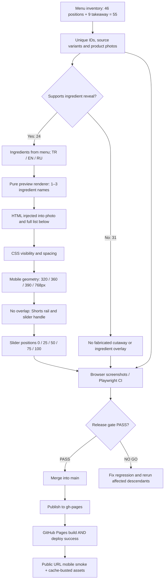

# Poçitel — Cutaway QA dependency graph
Last reviewed: 2026-11-10. Gate requires evidence, not just source-code presence.

## Dependency graph

## Inventory and intended scope

| Group | Main positions | Cutaway-enabled |
|---|---:|---:|
| Breakfast | 4 | 4 |
| Sweet & bites | 4 | 4 |
| Focaccia | 3 | 3 |
| Coffee | 9 | 0 |
| Hot drinks | 5 | 0 |
| Cold drinks | 5 | 0 |
| Tea & extras | 12 | 6 |
| Pairings / combos | 4 | 4 |
| Takeaway variants | 9 | 3 |
| **Total** | **55** | **24** |

No cutaway for drinks without a verified ingredient breakdown. The existing nutritional section is a separate feature.

## Required evidence for PASS

1. `node --test tests/*.test.mjs`: catalog IDs and all photo files exist; every main and takeaway variant in all three languages is either intentionally supported or intentionally excluded. The cutaway preview must contain actual menu-sourced ingredient text.
2. `npx playwright test tests/cutaway-browser.spec.mjs` with the local `dist` server: **all 24** supported cards have a visible in-photo ingredient caption at 390×844. The caption remains visible while the slider is at 0%, 25%, 75%, and 100% and neither overlaps the right-side Shorts rail nor the slider handle.
3. 320px / 360px / 768px responsive checks for TR, EN and RU must show the caption without clipping or overlap. Photos and controls must work on mobile browsers; Chrome emulation alone is not a WebKit/Safari pass.
4. Changes are merged to `main` only after tests pass. `gh-pages` publication must be based on the merged code, with its GitHub Pages **deploy** step successful. Public site smoke test must verify the deployed asset version. A successful branch push or build alone is not proof of public availability.

## Regression chain

- Data changed → rerun catalog + translations + photo checks → renderer → browser geometry.
- Social rail or layout changed → rerun overlay geometry, slider touch, accessibility and mobile checks.
- Slider logic changed → rerun 0/25/50/75/100 plus swipe/drag.
- HTML/CSS/JS cache changed → rerun published Pages smoke after deploy.

Known prior defect: ingredient caption used `left: calc(var(--cutaway-split) + 24px)`, which reduced available label space at a 50% split on a narrow card, and could be hidden at other slider positions. The corrected caption is anchored at the photo's top-left, away from the right rail, and does not disappear with slider movement.
